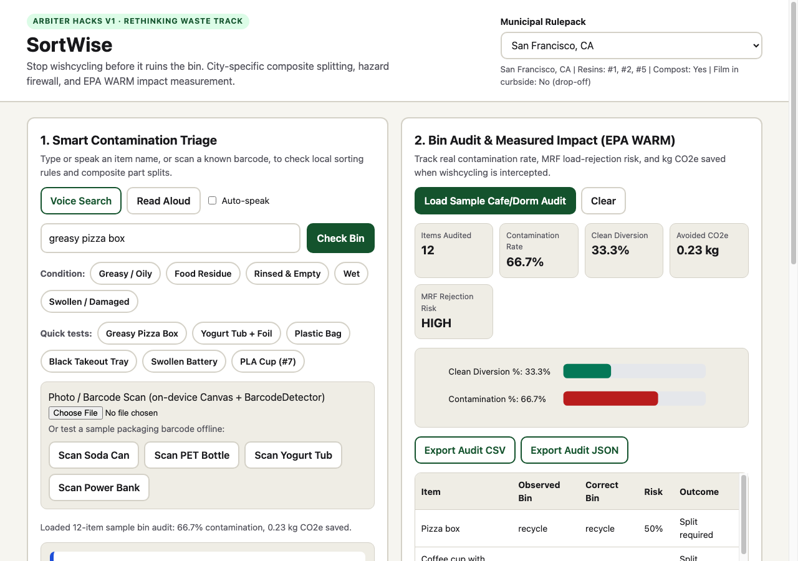
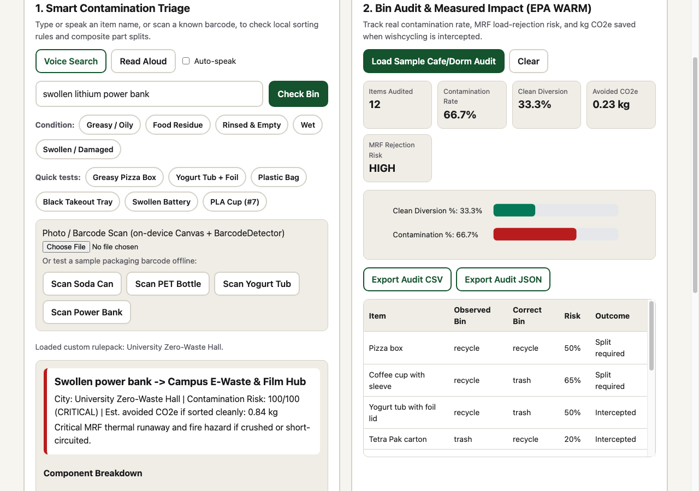
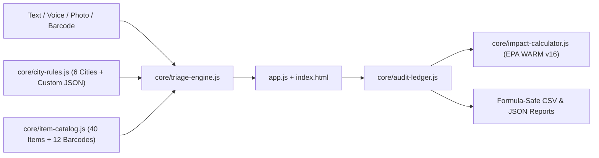

# SortWise

**Municipal contamination firewall, composite part splitter, and EPA WARM waste-impact studio.**

- **Live site:** [https://linhnguyen-gt.github.io/sortwise/](https://linhnguyen-gt.github.io/sortwise/)
- **Source repository:** [https://github.com/linhnguyen-gt/sortwise](https://github.com/linhnguyen-gt/sortwise)
- **Target track:** Arbiter Hacks V1 — Rethinking Waste

SortWise intercepts "wishcycling" before one greasy pizza box, plastic film bag, carbon-black tray, or lithium battery ruins an entire recycling load. It runs 100% client-side with zero external dependencies and includes municipal rulepacks for six cities plus custom JSON rulepack import.



## Key Features

- **City-Specific Rulepacks + Custom JSON Import:** Built-in rules for San Francisco, New York City, Seattle, Austin, London, and Ho Chi Minh City, plus `validateCustomRulepack()` so any campus, office, or municipality can load its own rules.
- **Part-by-Part Composite Splitting:** Automatically splits assemblies such as pizza boxes (clean lid vs. greasy bottom), yogurt tubs with foil peel lids, and takeaway coffee cups with cardboard sleeves.
- **Critical MRF Hazard Firewall:** Flags lithium batteries and swollen power banks (`100/100 CRITICAL` thermal runaway risk), plastic film tanglers, black NIR-invisible plastics, and broken glass.
- **Measured Impact Ledger (EPA WARM v16 Factors):** Audits real bins, separates clean diversion from wishcycling contamination, calculates avoided kg CO2e using EPA WARM v16 material proxies, and exports formula-safe CSV and JSON reports.
- **Hands-Free Voice & On-Device Scanner:** Supports Web Speech API dictation, spoken bin readback, `BarcodeDetector` (with 12 check-digit-valid sample barcodes), and Canvas image hints.

| HCMC + Swollen Battery Hazard | Custom Rulepack + SVG Impact Chart |
| --- | --- |
|  |  |

## Architecture



## Verification

Tested on Node `v24.18.0` and headless Google Chrome:

```bash
node --test tests/*.test.mjs
# 26/26 tests passing (0 failures)
```
